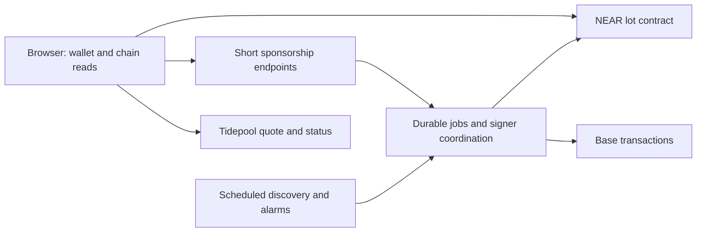

# Serverless deployment

Minting does not need a permanent application server. The browser already waits for Base finality and sends `mint_proven` through the owner's NEAR wallet. Keep the receiving address, employer transaction, and wallet mint flow unchanged.

The current blockers are sponsorship and settlement. `demoStream` funds a test stream and records it in local files. `pullStream` spends the funder's gas and waits for a Base receipt. The keeper waits through mining, MPC callbacks, and finality. These operations need durable progress and one coordinated signer before moving to serverless.

## Recommended shape

For a completely serverless deployment, use Cloudflare Workers for the app and a Durable Object for coordinated sponsorship. Its transactional storage fits the shared funder's nonce allocation; alarms can wake pending work without an always-running process. This is a proposed migration, not the current deployment.

The browser remains responsible for signing title operations, displaying chain state, polling submitted jobs, and tracking cash-out. Its keys do not move into the backend. The backend sponsors example streams, source pulls, and gas top-ups. Settlement stays permissionless.

Use one coordinator for each signing account. All consumers of the Base funder, including stream funding, pulling and keeper top-ups, must share its nonce allocation. A separate lock per lot does not solve this shared-account race.

A sponsorship endpoint accepts a validated request, creates or returns an existing operation, and responds immediately with its id and stage. Each worker invocation performs one bounded step and schedules the next check. For a stream, the steps include allowance or faucet funding when needed, approval, creation, and receipt confirmation. The browser never holds one HTTP request open through all of them.

Before broadcasting each EVM transaction, persist its nonce, signed bytes and hash. After a timeout, recover or rebroadcast those same bytes. Do not rebuild an uncertain payment at a new nonce. Scheduled work is retryable, not exactly once. Read contract state before each settlement step, and treat unavailable RPCs as pending work rather than proof of failure.

Replace `.quitclaim/demo-streams` with durable operation records. Preserve the current contract-and-recipient idempotency boundary. Move deployment credentials into server secrets. Port Bun filesystem and sleep calls out of the hosted execution path. Keep browser storage for the current recovery UX; a server-side cash-out journal would be separate work if cross-device recovery becomes a requirement.

## Vercel alternative

Vercel is a smaller web-hosting change because TanStack Start supports it through Nitro. It still needs durable storage and a background executor for sponsorship and settlement. Increasing a function timeout does not fix duplicate funding or signer nonce races.

For the shortest hackathon deployment, Vercel for the web app plus the existing keeper on a small persistent service is reasonable. For the specific requirement of no long-lived service, Cloudflare's durable coordination and scheduled wake-ups are the more direct fit.

Neither route requires a NEAR contract change or a Base wallet for the title owner. Requiring a Base wallet would simplify sponsorship by moving its cost to the user, but would weaken the NEAR-only experience. Keep the employer-funded flow and separate the optional demo sponsorship service.

## Implementation boundary

Deployment adapters and hosted job execution have not been added yet. Implement and verify durable submission, shared signer coordination, and bounded settlement before publishing the current sponsored endpoints on either platform. Test a restart after broadcasting but before recording a receipt, concurrent stream and pull requests, a lost response, and a Safe-finality wait spanning several invocations.

Official references, checked 2026-11-08:

- [TanStack Start hosting, including Vercel/Nitro and Cloudflare](https://tanstack.com/start/latest/docs/framework/react/guide/hosting)
- [Cloudflare's TanStack Start integration](https://developers.cloudflare.com/workers/framework-guides/web-apps/tanstack-start/)
- [Durable Object transactional storage](https://developers.cloudflare.com/durable-objects/api/sqlite-storage-api/)
- [Durable Object alarms and retry semantics](https://developers.cloudflare.com/durable-objects/api/alarms/)
