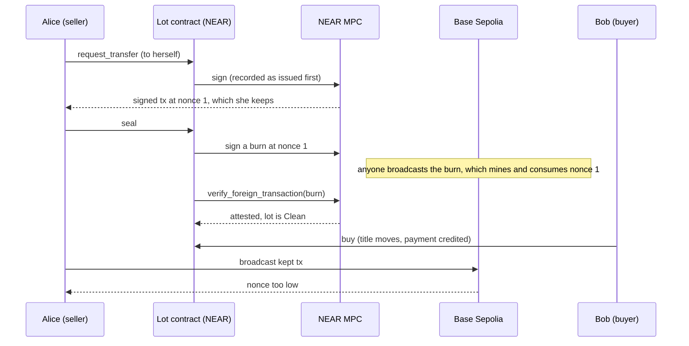

# Quitclaim

**An NFT that is the title to a Base address. Sell it or lease it, and the previous holder's signatures die first.**

Locked tokens already change hands over the counter, settled on trust. Buy someone's wallet and you can never be sure they didn't keep the key, or a withdrawal they signed before the sale.

Quitclaim makes the handover provable. A NEP-171 NFT on NEAR controls a Base Sepolia address through NEAR Chain Signatures, and no one ever holds its key. Before control changes hands, the contract burns the seller's outstanding Base nonce and NEAR MPC proves the burn landed. Anything the seller kept is now invalid.

## The proof, on chain

Alice owned a lot paying out a Sablier stream. Before selling it to Bob she signed a withdrawal to herself and kept it. Then:

1. Sealing the lot [burned her nonce on Base](https://sepolia.basescan.org/tx/0x1155eba522eb8bfc47fc7f4ad69782566131078ca87b2421f7de30455f933499).
2. NEAR MPC [proved the burn](https://testnet.nearblocks.io/txns/HyjkRYt84RQcbDdjiqTHun83mkz8op4RgUrHWaG7KPJw).
3. Bob [bought the title](https://testnet.nearblocks.io/txns/AS4Do5zxZATgCeBpFxEpAXRDch4QgdqwkW2c4Hequ3XA) and [withdrew to himself](https://sepolia.basescan.org/tx/0xc59f41515b1af3d8674f1cd20ff512d2bd2057052eb5070f852591886f2b793e).
4. Alice broadcast her kept withdrawal. Base rejected it: `nonce too low`.

To verify it yourself, with no wallet, keys or funds: `bun install && bun run heist`. The [judge guide](JUDGE.md) explains each check.

## How it works



- **Value:** a real Sablier Lockup v4 stream pays the lot address, non-cancelable and non-transferable. Anyone can pull it into the lot; only the controller can move tokens out.
- **Signing policy:** the contract only signs what it builds, an ERC-20 transfer of the lot's token or a nonce burn, and only for the current controller.
- **Minting:** no admin. `mint_proven` takes the stream's creation log, checks it pays the derived lot address, and has MPC attest that exact log on Base.
- **Handover:** a lot changes hands only when Clean, meaning every signature it issued is proven consumed.

## Sell or lease

- **Sell:** `buy` moves the title and credits the seller and the minter's royalty in one call.
- **Lease:** sell the next N days of unlocks and keep the rest. The lessee gets a lease NFT that controls the address until it ends, capped at what the stream vests during the term. Leases resell through the same proven handover.
- **Expiry:** anyone can seal. The lessee's leftover signatures are burned and proven, the lease NFT burns, and control returns to the owner. This time the buyer tried to keep it, and Base rejects that too.

## Why NEAR

Chain Signatures give the contract a native Base address it signs for under its own rules. MPC foreign-transaction verification lets it check, with no oracle of its own, that a Base transaction mined. Together they turn "the seller promises" into "the nonce is consumed, proven". NEAR's [NFT Chain Keys](https://github.com/near/multichain-gas-station-contract) already sell chain-signature keys as NFTs, but nothing consumes the seller's pending nonce on transfer. Quitclaim adds that proof.

## Limits

- Trusts NEAR's MPC network. The final deployment proves at Base `Safe` finality and has its upgrade keys deleted.
- The stream must pay a lot address from the start; existing wallets can't be imported.
- Sablier Labs [is in maintenance mode](https://blog.sablier.com/sablier-labs-is-entering-maintenance-mode); its contracts still run on chain. Not affiliated with Sablier.
- Testnet only. It demonstrates the mechanism; demand is unproven. A transferable stream, a Safe or ERC-6551 are genuine alternatives where the sender cooperates.

## Develop

Needs Bun, Rust 1.96 (`wasm32-unknown-unknown`), `cargo-near` and Foundry.

```sh
git submodule update --init
bun install
bun run verify
```

| Command | What it does |
| --- | --- |
| `bun run verify` | ABI check, type-check, unit tests, Sandbox tests, EVM build and tests |
| `bun run e2e [minting\|handover\|recovery\|lease]` | Adversarial suite against testnet; reports in `reports/` |
| `bun run keeper [--watch]` | Permissionless settling: gas, broadcast, prove, rescue, lease expiry |
| `bun run deploy-lot <account> [Latest\|Safe]` | Deploy the lot contract |
| `bun run build:release` | Reproducible build for the final deployment |
| `bun run freeze` | Delete the contract's keys after a passing Safe run. Irreversible |

Ops scripts read the root `.env` (see `.env.example`). `AGENTS.md` lists the security invariants.

[MIT](LICENSE).
