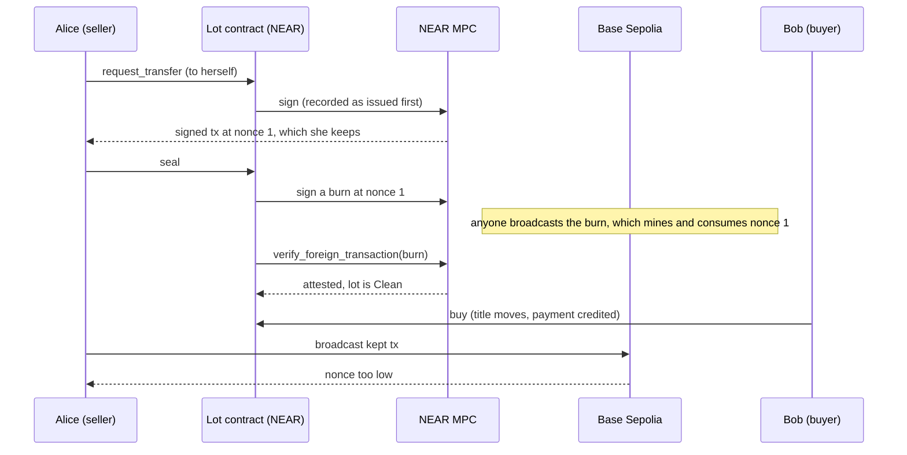

# Quitclaim

**An NFT that is the title to a Base address. Sell it or lease it, and the previous holder's signatures die first.**

Locked and vesting tokens already change hands. They trade over the counter at [steep discounts](https://www.theblock.co/post/396371/crypto-tokens-discounts-secondary-markets), settled on trust, or by handing over a wallet. A buyer of a wallet can never be sure the seller didn't keep a copy of the key, or a withdrawal they signed before the sale and will broadcast after it.

Quitclaim makes that handover provable. A NEP-171 NFT on NEAR controls a plain address on Base Sepolia through NEAR Chain Signatures, and nobody ever holds its private key. Before control changes hands, the contract burns the seller's outstanding Base nonce, and NEAR MPC proves on chain that the burn landed. Any transaction the seller kept is now invalid, and Base says so.

Every sale ends with a quitclaim: the seller's last claim, burned on Base and proven on NEAR.

## Try it in 30 seconds

```sh
bun install
bun run heist
```

No wallet, keys, `.env` or funds needed. The command checks a published handover against public chain data, then broadcasts the withdrawal Alice signed and kept before selling. Base rejects it:

```text
Base rejected it: nonce too low: next nonce 3, tx nonce 1
PASS Alice's retained withdrawal was rejected. Current owner: carol.quitclaim-spike-43135.testnet.
```

The [judge guide](JUDGE.md) explains each check and links every transaction.

## How it works



1. **The title.** Each lot is an NFT whose Base address is derived by Chain Signatures from the contract and `<minter>/<name>`. The contract asks MPC to sign only for the NFT's controller, and only transactions it builds itself: an ERC-20 `transfer` of the token fixed at mint, or a nonce burn. No raw signing, no approvals, no other calls.
2. **The value.** A real [Sablier Lockup v4](https://docs.sablier.com) stream pays the lot address. It is created non-cancelable and non-transferable, so nobody can cancel it or redirect it. Anyone can pull vested tokens into the lot; only the controller can move them out.
3. **Admin-free minting.** `mint_proven` takes the stream's creation log. The contract checks it is Sablier's event, non-cancelable, non-transferable and paying the derived address, then has MPC attest that exact log on Base. Anyone front-running the mint gets a different derived address, so the check fails.
4. **The handover.** Every signature request is recorded before it's signed, since MPC signatures are public. Sealing burns the outstanding nonce, and `prove` asks MPC `verify_foreign_transaction` to attest the burn mined, using only hashes from contract state. Only then is the lot Clean, and only a Clean lot can change hands.

## What you can do with a lot

- **Sell it.** List a Clean lot at a fixed price. `buy` moves the title and credits the seller and the minter's royalty (up to 10%) in one call, with no cross-contract calls. Payouts are pulled.
- **Lease it.** "Sell the next 90 days of unlocks, keep the rest." The owner offers a term; the lessee pays and receives a lease NFT (`<id>-lease`) that controls the address until it ends. The lessee can move out at most what the stream vests during the lease, computed from the attested schedule with Sablier's own formula. The title can't move while a lease exists.
- **Resell a lease.** The lease NFT is sold through the same Clean handover, so the old lessee's kept signatures die before the new one takes over.
- **Let it expire.** After the end, anyone can seal. The lessee's leftover signatures are burned and proven, the lease NFT burns, and control returns to the title holder. The heist runs in reverse: this time the buyer tried to keep it, and Base rejects that too.

Each lot's NFT shows an on-chain SVG title card in any NEAR wallet: lot, Base address, stream and state, plus end date and remaining budget for a lease.

## Why NEAR

- **Chain Signatures** give a NEAR contract a native Base address it signs for, under a policy the contract enforces. There's no bridge and no smart account on Base.
- **MPC foreign-transaction verification** lets the same contract learn, without an oracle of our own, that a specific Base transaction mined at a chosen finality. That is what turns "the seller promises" into "the nonce is consumed, proven".
- **NEP-171** makes the title an ordinary NEAR NFT that wallets, explorers and marketplaces already understand.

NEAR's own [NFT Chain Keys](https://github.com/near/multichain-gas-station-contract) already sell chain-signature keys as NFTs. Its transfer revokes approvals and moves the token, but nothing consumes the seller's outstanding foreign nonce, so a transaction signed before the transfer can still be broadcast after it. Quitclaim adds that missing step: the handover proof.

## NFT track checklist

| The track asks | Where to see it |
| --- | --- |
| What stops the old owner keeping access? | `bun run heist`; the `handover` and `lease` e2e reports in `reports/` |
| Only the current holder can act | e2e rows "alice requests after the sale" and "alice requests during the lease" |
| A sale in the middle of a payout | e2e row "outsider pulls the stream while listed": the lot's total never drops |
| What it earned, what it paid out, who held it | each e2e report lists every NEAR and Base transaction; the title card shows the stream |
| Every way a seller could try to keep the money | the threat table below, each row backed by a test or an e2e step |

## Threats and defences

| Attempt | What stops it |
| --- | --- |
| Seller broadcasts a withdrawal signed before the sale | The nonce is burned and proven before the title moves; Base rejects it |
| Seller broadcasts first, while sealing | The burn replaces it at a higher fee; Base drops the withdrawal |
| Seller asks for a new signature after the sale | The contract refuses: not the controller |
| Transfer while a signature request is pending | Not Clean, so the transfer is refused |
| Forged proof: the same payload signed with another key | Signatures must `ecrecover` to the lot address; proofs use hashes from contract state |
| Front-run mint of someone else's stream | The path is `<caller>/<name>`, so the recipient check fails |
| Mint against a cancelable or transferable stream | Refused from the attested creation log |
| Lessee takes more than the term's income | Each request is charged against the vested budget at signing time |
| Lessee keeps a signature past expiry | Expiry seals, burns and proves before control returns |
| A transfer mines but reverts | `rescue` burns the next nonce; proving it proves both |

## Trust and limits

- **MPC.** Signing and attestation rely on NEAR's MPC network and its RPC-provider quorum. Base reorganisations beyond the proof's finality remain a risk; the final deployment proves at `Safe`.
- **Upgrade keys.** Development deployments keep a full-access key. The final deployment has every full-access key deleted (`bun run freeze`) after its full e2e suite passes at Safe, and `bun run heist` reports whether the contract is frozen.
- **Purpose-created addresses.** The stream must pay a lot address from the start; existing wallets can't be imported. Minting is permissionless and doesn't need the stream sender's approval of a sale.
- **Sablier.** Sablier Labs [entered maintenance mode](https://blog.sablier.com/sablier-labs-is-entering-maintenance-mode) in July 2026. Its contracts run on chain permanently, and Quitclaim calls them directly. Quitclaim is not affiliated with Sablier.
- **Testnet.** Everything runs on NEAR testnet and Base Sepolia with a test token. This demonstrates the mechanism; customer demand is unproven.

**Hard questions.** If the stream's sender offers a transferable Sablier stream, trading its NFT is simpler. A [Safe with owner rotation](https://docs.safe.global/reference-smart-account/owners/swapOwner) or an [ERC-6551 account](https://eips.ethereum.org/EIPS/eip-6551) is a genuine alternative too. Quitclaim's angle is a native address with a fixed, inspectable signing policy, a NEAR NFT title, one-call settlement, and an on-chain proof that the previous holder's signatures are dead. It doesn't claim this is impossible elsewhere.

## Roadmap

- **More sources:** an immutable checkout contract whose sales pay a lot ("sell the cash register"), and Sablier Merkle airdrops.
- **Revocable grants:** hand a lot to an agent and revoke it with a receipt proving nothing it was issued can still land.
- **More chains:** Arbitrum, which MPC verification already supports.

## For developers

**Layout.** `contracts/lot` is the NEAR contract (Rust, `cargo near`). `contracts/evm` is the test ERC-20 (Foundry). `packages/shared` holds chain config, address derivation and the ABI-generated types. `packages/ops` holds the Bun scripts. `apps/web` is the frontend.

**Setup.** Needs Bun, Rust 1.96 with `wasm32-unknown-unknown`, `cargo-near` and Foundry.

```sh
git submodule update --init
bun install
bun run verify
```

`bun run verify` checks the generated ABI, type-checks, runs the TS and contract unit tests, runs the deployed WASM in NEAR Sandbox against a local MPC stand-in, and builds and tests the EVM contracts.

**Commands.**

| Command | What it does |
| --- | --- |
| `bun run heist [evidence.json]` | Verifies a published handover and replays the kept transaction, keyless |
| `bun run test:heist` | Runs the heist with an empty home, working directory and environment |
| `bun run e2e [minting\|handover\|recovery\|lease]` | The adversarial suite on fresh lots against testnet; writes `reports/` with every transaction link |
| `bun run keeper [--watch]` | Settles lots: ends run-out leases, tops up gas, broadcasts, proves, rescues. Every action is permissionless |
| `bun run deploy-lot <account> [Latest\|Safe]` | Creates the account and deploys the lot contract |
| `bun run lot-address <contract> <path>` | Prints a lot's Base address |
| `bun run build:release` | Reproducible build in a digest-pinned Docker image, for the final deployment |
| `bun run freeze` | Deletes every full-access key on `LOT_CONTRACT`, once, after the Safe e2e suite passes on the deployed code. Irreversible |
| `bun run dev` | Serves the frontend |

Ops scripts read the root `.env`; copy `.env.example` and set every account. The lot address depends on the contract account and the path, so changing either orphans every lot. `AGENTS.md` lists the security invariants and gotchas; fee rules, recovery and lease budgeting are documented in the contract source.

## License

[MIT](LICENSE).
