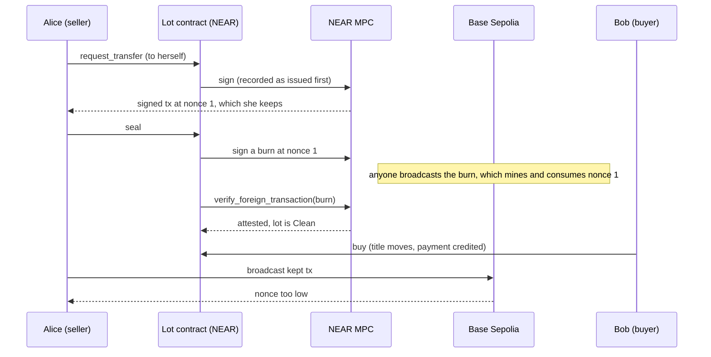

# Quitclaim

**Sell a stream of locked tokens, or sell a period of its unlocks and keep the rest.**

A Quitclaim NFT is the title to a Base address receiving a token stream. Sell the title permanently, or lease withdrawal control for a fixed term. Before control changes hands, the previous holder's outstanding signatures must be proven consumed.

Locked tokens already change hands over the counter, settled on trust. Buy someone's wallet and you can never be sure they didn't keep the key, or a withdrawal they signed before the sale.

Quitclaim makes the handover provable. A NEP-171 NFT on NEAR controls a Base Sepolia address through NEAR Chain Signatures, and no one ever holds its key. Before control changes hands, the contract burns the seller's outstanding Base nonce and NEAR MPC proves the burn landed. Anything the seller kept is now invalid.

## Sell the title or lease the unlocks

Sell the title to transfer control of the lot, including its remaining stream and tokens already held at its address. The purchase moves the title and credits the seller and the minter's royalty in one NEAR call.

Or sell a lease for the next 30 days of unlocks while keeping the title. The buyer gets a lease NFT and can withdraw as tokens vest, up to the amount the attested stream schedule vests during the term. The lease does not grant unrestricted access to the lot's existing balance.

The buyer can resell the remaining lease through the same proven handover. Resale carries forward the allowance already charged. At expiry, anyone can start settlement. Control returns to the title owner only after outstanding signatures are proven consumed and the lease NFT burns.

## Why choose this over a transferable stream?

For a permanent sale of a stream alone, a transferable stream NFT is simpler. Quitclaim adds a bounded, resellable lease of withdrawal control. Transferring a stream NFT alone does not provide a temporary right to its unlocks or settle the return of control.

Quitclaim also keeps the remaining stream and tokens already withdrawn into the lot under the same control. Every sale, lease resale, and lease return requires proof that the previous controller's outstanding signatures can no longer execute. Other systems could implement comparable rights. Quitclaim demonstrates them with a NEAR NFT controlling a native Base address.

The stream must be created with the lot address as its recipient. Quitclaim cannot import an existing position from an ordinary wallet, and the demo does not establish demand or the stream sender's approval of a sale.

## The proof, on chain

Alice owned a lot paying out a Sablier stream. Before selling it to Bob she signed a withdrawal to herself and kept it. Then:

1. Sealing the lot [burned her nonce on Base](https://sepolia.basescan.org/tx/0xfea518dcfa71c8ab8be27b1ac47113e8f3f361d3d8ef88b12f63bfc444b9120f).
2. NEAR MPC [proved the burn](https://testnet.nearblocks.io/txns/62p8FSxwKYbkf1bUkdGrgntKrLHGWxRhTo8rGb9ALw8f).
3. Bob [bought the title](https://testnet.nearblocks.io/txns/G7ZryHuHB7gFgLLr4uRnQo1UeKTVSfXjEHAp7V9YAjab) and [withdrew to himself](https://sepolia.basescan.org/tx/0xb3c7d0ac1cba600f5afdcc41f45ae65ae1c5d3319f19a6ff6f3950bedfcad599).
4. Alice broadcast her kept withdrawal. Base rejected it: `nonce too low`.

To verify it yourself, with no wallet, keys or funds: `bun install && bun run heist`. The [judge guide](JUDGE.md) explains each check.

## Try it in the browser

Run the web app locally. Browsing needs only the contract name, no keys:

```sh
bun install
printf 'LOT_CONTRACT=quitclaim.testnet\nVITE_LOT_CONTRACT=$LOT_CONTRACT\n' > .env
bun run dev   # http://localhost:3000
```

1. On the home page, press **Try live replay**. The app checks the published sale from public NEAR and Base RPCs, then broadcasts Alice's kept withdrawal. Base rejects it with `nonce too low`.
2. Open **Market** and the 4-year grant listed at 4 NEAR. The chart shows its 1-year cliff. Under **Signatures**, nonce 0 is used, and **History** shows it proven consumed before the listing.
3. Open the lot leased to Carol. The offer box shows who controls the address until the lease ends, and the title checks show it isn't sealed for transfer.
4. Connect a NEAR testnet wallet with a few testnet NEAR and buy the stream that is nearly finished, listed at 0.4 NEAR. It moves to **Portfolio**, and the lot page lists you as owner of the same Base address. If another judge bought it first, buy any listed lot.

The market comes from `bun run seed`: six vesting scenarios on test USDC, from a fresh grant to a resold one.

## How it works



- **Value:** a real Sablier Lockup v4 stream of Tidepool's test USDC pays the lot address, non-cancelable and non-transferable. Anyone can pull it into the lot; only the controller can move tokens out.
- **Signing policy:** the contract only signs what it builds, an ERC-20 transfer of the lot's token or a nonce burn, and only for the current controller.
- **Minting:** no admin. `mint_proven` takes the stream's creation log, checks it pays the derived lot address, and has MPC attest that exact log on Base.
- **Handover:** a lot changes hands only when Clean, meaning every signature it issued is proven consumed.
- **Cash-out:** `bun run cash-out` swaps a lot's USDC for Tidepool test wNEAR (no value) on NEAR, as in this [Base deposit](https://sepolia.basescan.org/tx/0xa947e23f55253fa6e7d080a6a557a9a210dc02d2b75e66957121fc6649f2bde0) and [NEAR payout](https://testnet.nearblocks.io/txns/B272rVHcmYiqpQgQi8RdjqkpX7Cm26N4SByrqginAQvm). It is a cross-chain cash-out through Tidepool's community-run, 1Click-compatible sandbox on the NEAR Intents verifier, with custodial deposit addresses, trusted bridges, one solver and no SLA. The core proof doesn't depend on it.

## Why NEAR

Chain Signatures give the contract a native Base address it signs for under its own rules. MPC foreign-transaction verification lets it check, with no oracle of its own, that a Base transaction mined. Together they turn "the seller promises" into "the nonce is consumed, proven". NEAR's [NFT Chain Keys](https://github.com/near/multichain-gas-station-contract) already sell chain-signature keys as NFTs, but nothing consumes the seller's pending nonce on transfer. Quitclaim adds that proof.

## Limits

- Trusts NEAR's MPC network. `quitclaim.testnet` proves at Base `Safe` finality and has no access keys, so nobody can upgrade it. Check with `near account list-keys quitclaim.testnet network-config testnet now`.
- The stream must pay a lot address from the start; existing wallets can't be imported.
- Sablier Labs [is in maintenance mode](https://blog.sablier.com/sablier-labs-is-entering-maintenance-mode); its contracts still run on chain. Not affiliated with Sablier.
- Testnet only. It demonstrates the mechanism; demand is unproven. A transferable stream, a Safe or ERC-6551 are genuine alternatives where the sender cooperates.

## Develop

Needs Bun, Rust 1.96 (`wasm32-unknown-unknown`) and `cargo-near`.

```sh
bun install
bun run verify
```

| Command                                            | What it does                                                              |
| -------------------------------------------------- | ------------------------------------------------------------------------- |
| `bun run verify`                                   | ABI check, type-check, unit tests, Sandbox tests                          |
| `bun run e2e [minting\|handover\|recovery\|lease]` | Adversarial suite against testnet; reports in `reports/`                  |
| `bun run dev`                                      | Serve the web app on `PORT` (default 3000)                                |
| `bun run seed`                                     | Put six vesting scenarios on the market (spends 100 test USDC)            |
| `bun run keeper [--watch]`                         | Permissionless settling: gas, broadcast, prove, rescue, lease expiry      |
| `bun run cash-out <lot-id> <owner> [usdc]`         | Swap a lot's USDC for Tidepool test wNEAR (no value) through NEAR Intents |
| `bun run deploy-lot <account> [Latest\|Safe]`      | Deploy the lot contract                                                   |
| `bun run build:release`                            | Reproducible build for the final deployment                               |
| `bun run freeze`                                   | Delete the contract's keys after a passing Safe run. Irreversible         |

Ops diagnostics use Pino on stderr, with readable terminal output and JSON when redirected. Set `LOG_LEVEL=warn` to reduce diagnostic output. Command results such as `lot-address` and the heist transcript stay on stdout.

Ops scripts read the root `.env` (see `.env.example`). `AGENTS.md` lists the security invariants.

[MIT](LICENSE).
